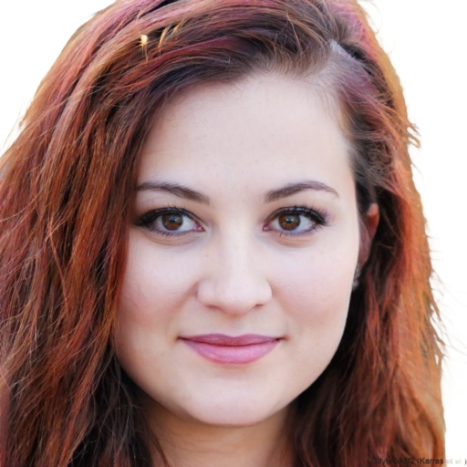
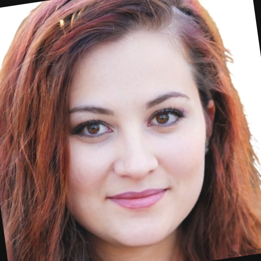
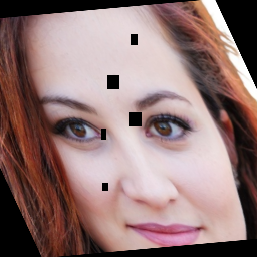
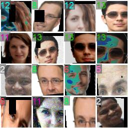
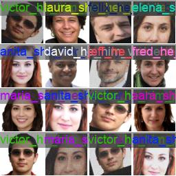
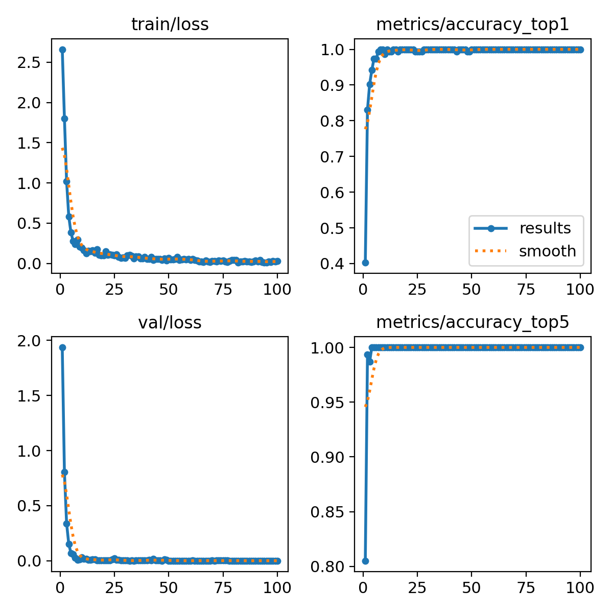
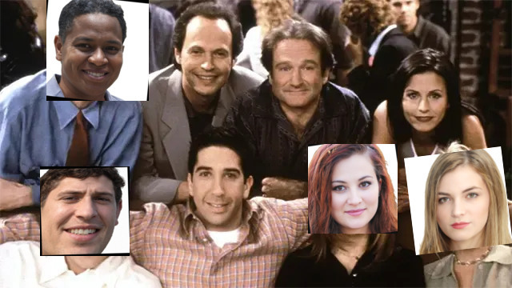

# Personnel classification with 2D augmentation and YOLO

This project trains an image classifier to recognize 14 personnel classes from a small portrait dataset. It expands each portrait with randomized 2D transformations, fine-tunes a YOLO26n classification model, and combines that classifier with a YOLOv8n person detector to label people in a larger image.

The three scripts handle dataset generation, training, and prediction:

```text
personnel/*.png ── 2d_augment.py ──> augmented_personnel/
                                            │
                                      train_yolo.py
                                            │
                                   trained best.pt
                                            │
test.jpg ── YOLOv8n person detection ──> person crops ──> classifier
                                                            │
                                             labels + confidence scores
                                                            │
                                                  test_annotated.jpg
```

## How the 2D augmentations work

[`2d_augment.py`](2d_augment.py) reads PNG portraits from `personnel/`. If `personnel.zip` exists, it first extracts the archive beside the script. Each filename becomes a class label: for example, `anita_she_her_quality_inspector.png` creates a class named `anita_she_her_quality_inspector`. These names, pronouns, and roles are supplied dataset labels; the model learns to select the whole label.

For each portrait, the script independently transforms the original image **50 times for training** and **10 times for testing**. It also saves the unchanged original in the test folder. Each variant starts from the original, rather than applying another transformation to the previous variant.

| Original portrait | Training variant `0` | Training variant `49` |
| :---: | :---: | :---: |
|  |  |  |

*Actual saved images from the dataset. Later indices allow stronger transformations, but random sampling means an individual later image is not necessarily more distorted.*

The transformations run in this order through an Albumentations `Compose` pipeline. Each has its own probability of being applied, so several effects can appear in one image.

| Transformation | Probability | What it changes |
| --- | ---: | --- |
| `Perspective` | 70% | Warps the image plane to approximate an oblique viewing angle. |
| `Affine` | 70% | Changes scale, in-plane rotation, and shear. |
| `RandomBrightnessContrast` | 70% | Varies exposure and contrast to represent different lighting. |
| `MotionBlur` | 30% | Blurs details to approximate movement during capture. |
| `GaussNoise` | 30% | Adds random pixel noise. |
| `ImageCompression` | 40% | Introduces compression artifacts by varying encoding quality. |
| `CoarseDropout` | 30% | Hides small rectangular patches to approximate partial occlusion. |

For training index `i = 0…49`, the allowed ranges widen gradually. Rotation grows from ±10° to approximately ±27.6°, scale expands from `0.9–1.1` to approximately `0.724–1.276`, and the maximum motion-blur kernel grows from 3 to 15 pixels. Brightness, contrast, noise, perspective distortion, compression severity, and dropout size also vary with the index. Test variants use a separate schedule for `j = 0…9` with similar effects.

These are **2D image transformations**: they modify existing pixels and do not reconstruct a 3D face or generate genuinely new viewpoints. The script does not fix a random seed, so regenerating the dataset changes the sampled images. Rerunning overwrites matching output filenames and does not remove stale files from earlier datasets.

### Dataset structure

The current dataset contains 14 classes, with one original portrait per class:

| Split | Images per class | Total |
| --- | ---: | ---: |
| `train/` | 50 augmented portraits | 700 |
| `test/` | 10 augmented portraits + 1 original | 154 |

```text
augmented_personnel/
├── train/
│   └── anita_she_her_quality_inspector/
│       ├── anita_she_her_quality_inspector_augmented_0.png
│       └── ...
└── test/
    └── anita_she_her_quality_inspector/
        ├── anita_she_her_quality_inspector_augmented_0.png
        ├── ...
        └── anita_she_her_quality_inspector_original.png
```

Other classes follow the same layout. The class folders supply the labels; this classification dataset has no bounding-box annotation files. See the [Ultralytics classification dataset format](https://docs.ultralytics.com/datasets/classify/).

## Training the YOLO classifier

[`train_yolo.py`](train_yolo.py) loads the pretrained **`yolo26n-cls.pt`** model and fine-tunes it on `augmented_personnel/`:

```python
model = YOLO("yolo26n-cls.pt")
model.train(data="/path/to/augmented_personnel", epochs=100, imgsz=64)
```

The script requests **100 epochs** with **64 × 64 classification inputs**. The saved [run configuration](runs/classify/train/args.yaml) records batch size 16, pretrained initialization, and additional training augmentation settings such as RandAugment, horizontal flipping, and random erasing. These training-time transformations are separate from the images written by `2d_augment.py`.

| Training batch | Saved classification predictions |
| :---: | :---: |
|  |  |

*These are existing Ultralytics run artifacts. The training mosaic displays numeric class IDs; the prediction mosaic displays class names, some clipped by the small tiles. The prediction mosaic evaluates individual portraits, not the full person-detection pipeline.*

The saved checkpoints are:

- [`runs/classify/train/weights/best.pt`](runs/classify/train/weights/best.pt): the checkpoint used by `predict.py`.
- [`runs/classify/train/weights/last.pt`](runs/classify/train/weights/last.pt): the final training checkpoint.

### Reading the saved results



The final row of [`results.csv`](runs/classify/train/results.csv) reports top-1 and top-5 accuracy of `1.0` (100%). Top-1 measures whether the highest-scoring class is correct; top-5 measures whether the correct class is among the five highest-scoring classes.

**This score does not establish accuracy on unseen camera captures.** Both generated splits come from the same 14 original portraits, and the original portraits themselves are included in `test/`. The folder contains no separate `val/` split. Although the run artifacts use validation filenames, the dataset does not provide independently captured validation portraits. A stronger evaluation would split distinct source photographs or recording sessions before augmentation and reserve separate images for final testing.

## How YOLO predictions work

[`predict.py`](predict.py) uses two different models in sequence:

| Stage | Model | Output |
| --- | --- | --- |
| Locate people | `yolov8n.pt` | Bounding boxes for detections in class `0` (`person`). |
| Classify each crop | `runs/classify/train/weights/best.pt` | A personnel class and its classification confidence. |

1. Open `test.jpg` with OpenCV.
2. Run `detector.predict(source=img, classes=[0])` to detect people.
3. Convert each box to integer coordinates and crop `img[y1:y2, x1:x2]`. Empty crops are skipped.
4. Pass each crop to the custom classifier.
5. Read `probs.top1`, resolve its name through `names`, and read `probs.top1conf`.
6. Print the class and confidence, draw a green box and label, and save `test_annotated.jpg`. Matplotlib displays the annotated image after converting OpenCV's BGR colors to RGB.



*The supplied `test.jpg` is a composite input used to exercise the pipeline. This is the input image, not an annotated detection result. Running `predict.py` creates the output.*

The detector finds **people**, not face landmarks or face-only boxes, so its crops can include clothing and background. The classifier labels the supplied crop; it does not locate a face within it. Ultralytics applies its own classification preprocessing before inference, as described in the [classification documentation](https://docs.ultralytics.com/tasks/classify/).

The percentage drawn on the image is the **classifier's top-class confidence**, not the detector's confidence or a guarantee of identity. The script has no unknown-person class or rejection threshold: every valid detected crop receives one of the trained labels. People absent from the training set can therefore receive a known person's label. The `yolo26n.pt` detector file also present in this folder is not used by these scripts.

## Run the project

Clone the repository and enter its directory:

```bash
git clone https://github.com/VidDolinsek/FaceClassifierWithCustomAugmentation.git
cd FaceClassifierWithCustomAugmentation
```

The repository includes the original portraits, saved training results, and custom `best.pt` and `last.pt` checkpoints. The generated `augmented_personnel/` dataset is ignored by Git; recreate it with `2d_augment.py` before training. The optional local `personnel.zip` archive is also ignored because its portraits are included individually. Pretrained `yolo*.pt` files are not committed; Ultralytics downloads the requested official models on first use, which requires internet access.

Create an environment and install the script dependencies:

```bash
python3 -m venv .venv
source .venv/bin/activate
python -m pip install ultralytics 'albumentations>=2,<3' opencv-python matplotlib
```

The augmentation script uses Albumentations 2.x argument names, including `std_range`, `quality_range`, and `num_holes_range`. Exact package versions for the saved training run are not recorded in a dependency lockfile.

Before training or prediction, update the absolute paths currently pointing into `/home/videk/Desktop/faks/rins/face_classification`:

| File | Paths to update |
| --- | --- |
| `train_yolo.py` | The `data` argument pointing to `augmented_personnel/`. |
| `predict.py` | `classifier_path`, `image_path`, and `output_path`. |

`2d_augment.py` resolves its paths relative to its own location. The pretrained model filenames in the other two scripts are relative to the working directory.

```bash
# 1. Generate training and test images from personnel/*.png.
python 2d_augment.py

# 2. Train the personnel classifier.
python train_yolo.py

# 3. Detect people and classify their image crops.
python predict.py
```

To use the existing `best.pt`, skip augmentation and training and run prediction after configuring the paths. New training runs may be saved under `train2/`, `train3/`, and so on; point `classifier_path` to the intended checkpoint. `predict.py` opens a Matplotlib window; for a terminal-only run, use `MPLBACKEND=Agg python predict.py` to save the image without an interactive window.

## Files and saved examples

| Path | Purpose |
| --- | --- |
| `personnel/`, optional `personnel.zip` | Included original portraits and an optional local archive. |
| `2d_augment.py` | Creates the augmented class-folder dataset. |
| `augmented_personnel/` | Generated training and test images. |
| `train_yolo.py` | Fine-tunes the YOLO26n classifier. |
| `predict.py` | Runs person detection, crop classification, and annotation. |
| `runs/classify/train/` | Saved settings, metrics, plots, and trained checkpoints. |
| `test.jpg` | Supplied input for the detection-and-classification demo. |
| `docs/images/` | Copies of existing project images used in this README, kept stable when runs are regenerated. |

This folder supplies the personnel-classification training workflow used by the larger ROS 2 inspection project. Its runtime consumer is [`face_classification_publisher.py`](https://github.com/VidDolinsek/ROS2-Project/blob/main/scripts/face_classification_publisher.py); configure that node with the trained classifier checkpoint when integrating with the robot.
